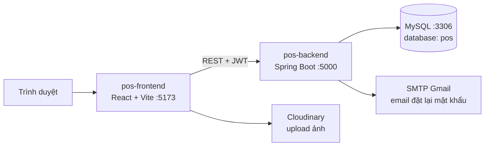

# 🛒 POS Application — Hệ thống bán hàng (POS) SaaS đa cửa hàng

<p align="center">
  
</p>

<p align="center">
  
  
  
  
  
  
  <a href="LICENSE"></a>
</p>

**POS Application** là hệ thống quản lý bán hàng tại quầy dành cho chuỗi cửa hàng bán lẻ. Hệ thống hỗ trợ mô hình **đa cửa hàng (multi-tenant)** theo cấu trúc *Cửa hàng → Chi nhánh → Nhân viên*, phân quyền theo vai trò, quản lý kho, ca làm việc, hoàn trả, báo cáo phân tích và gói đăng ký (subscription).

---

## 📋 Mục lục

- [Tính năng](#-tính-năng)
- [Kiến trúc](#-kiến-trúc)
- [Hệ thống Gói đăng ký & Ràng buộc tài nguyên](#-hệ-thống-gói-đăng-ký--ràng-buộc-tài-nguyên-subscription--entitlements)
- [Công nghệ](#-công-nghệ)
- [Cấu trúc thư mục](#-cấu-trúc-thư-mục)
- [Cài đặt & chạy](#-cài-đặt--chạy)
- [Cấu hình](#-cấu-hình)
- [Vai trò & giao diện](#-vai-trò--giao-diện)
- [API](#-api)
- [Bảo mật](#-bảo-mật)
- [Ảnh chụp màn hình](#-ảnh-chụp-màn-hình)
- [Hạn chế đã biết & hướng phát triển](#-hạn-chế-đã-biết--hướng-phát-triển)
- [Giấy phép](#-giấy-phép)

---

## 🚀 Tính năng

| Nhóm | Mô tả |
|------|-------|
| 🏪 **Cửa hàng & chi nhánh** | Đăng ký cửa hàng, quản lý nhiều chi nhánh, duyệt/khóa cửa hàng (`ACTIVE`, `PENDING`, `BLOCKED`) |
| 📦 **Sản phẩm & danh mục** | CRUD sản phẩm, danh mục theo cửa hàng, tìm kiếm, upload ảnh |
| 🗃️ **Kho hàng** | Tồn kho theo từng chi nhánh, cảnh báo tồn kho thấp |
| 🛒 **Bán hàng (POS)** | Giỏ hàng, thanh toán `CASH` / `CARD` / `UPI`, mã giảm giá (coupon), tìm khách hàng, xuất hóa đơn PDF |
| 🔁 **Hoàn trả** | Tạo và tra cứu phiếu hoàn trả theo thu ngân, chi nhánh, ca |
| ⏱️ **Ca làm việc** | Mở/đóng ca, tổng kết ca của thu ngân |
| 👥 **Nhân viên & khách hàng** | Gán nhân viên vào cửa hàng/chi nhánh, quản lý hồ sơ khách hàng |
| 📊 **Phân tích** | Dashboard theo chi nhánh, cửa hàng và Super Admin (biểu đồ Recharts) |
| 💳 **Gói đăng ký & Entitlements** | 7 tính năng cố định (Fixed Features), kiểm soát giới hạn cứng (chi nhánh, người dùng, sản phẩm), chặn hạ cấp không hợp lệ, Feature Gate bảo vệ |
| 🔐 **Xác thực** | Đăng ký, đăng nhập JWT, quên/đặt lại mật khẩu qua email, đổi mật khẩu |

---

## 🏗️ Kiến trúc

Mô hình **Frontend (SPA) + Backend (REST API) + MySQL**, giao tiếp qua JSON và JWT.



Backend theo kiến trúc phân lớp:

```
Controller (REST)  →  Service (nghiệp vụ)  →  Repository (Spring Data JPA)  →  MySQL
        ↑                    ↑
   DTO / Mapper        Entity (package modal)
```

---

## 💳 Hệ thống Gói đăng ký & Ràng buộc tài nguyên (Subscription & Entitlements)

Mô hình SaaS của POS áp dụng cơ chế quản lý gói dịch vụ và kiểm soát tài nguyên nghiêm ngặt:

### 1. 7 Tính năng cố định (Fixed Plan Features)
Thay vì các tính năng nhập tự do không gắn logic, hệ thống chuẩn hóa thành **7 tính năng cố định** tương ứng với các trường dữ liệu boolean trên `SubscriptionPlan` (`PlanFeature`):

| Tính năng | Cờ (`field`) | Mô tả & Ràng buộc nghiệp vụ |
|-----------|--------------|------------------------------|
| **Advanced Reports** | `advancedReports` | Báo cáo phân tích chuyên sâu (doanh thu theo tháng, theo danh mục hàng). Khi tắt: chặn API phân tích và hiển thị Feature Gate khóa màn hình báo cáo tại Store & Branch. |
| **Inventory System** | `inventory` | Quản lý kho hàng chi nhánh. Khi tắt: khóa màn hình quản lý kho; tại POS bỏ qua giới hạn tồn kho để bán hàng thông suốt. Khi bật: kiểm tra tồn kho nghiêm ngặt và tự động trừ kho khi bán. |
| **Multi-location** | `multiLocation` | Cho phép chuỗi nhiều chi nhánh. Khi tắt: cửa hàng bị giới hạn tối đa **1 chi nhánh duy nhất**. Chặn tạo chi nhánh thứ hai khi chưa kích hoạt tính năng này. |
| **Invoice Branding** | `invoiceBranding` | Tùy biến thương hiệu trên hóa đơn. Khi tắt: hóa đơn in/PDF chỉ hiển thị thông tin chung, ẩn nhãn hiệu cửa hàng. |
| **Integrations** | `integrations` | Cho phép kết nối API và cổng dịch vụ bên thứ ba. |
| **eCommerce** | `ecommerce` | Cho phép tích hợp và đồng bộ hóa với sàn/kênh thương mại điện tử. |
| **Priority Support** | `prioritySupport` | Đánh dấu ưu tiên hỗ trợ đặc quyền dành cho các gói doanh nghiệp. |

### 2. Giới hạn tài nguyên cứng (Hard Resource Limits)
Mỗi gói dịch vụ quy định các giới hạn tối đa (>= 1):
- `maxBranches`: Giới hạn số lượng chi nhánh tối đa được phép tạo.
- `maxUsers`: Giới hạn tổng số lượng nhân viên / người dùng thuộc cửa hàng.
- `maxProducts`: Giới hạn tổng số lượng sản phẩm tối đa của cửa hàng.

Tất cả các hành động tạo chi nhánh (`POST /api/branches`), thêm nhân viên (`POST /api/employees`), tạo sản phẩm (`POST /api/products`) đều được kiểm tra tức thời thông qua `PlanLimitChecker`. Nếu chạm trần giới hạn, API sẽ từ chối và phản hồi lỗi chi tiết.

### 3. Kiểm soát Chuyển đổi / Hạ cấp gói (Downgrade Validation)
- Khi cửa hàng thực hiện chuyển gói (`POST /api/subscriptions/subscribe`), hệ thống tự động đối chiếu số lượng tài nguyên thực tế đang sử dụng (`usedBranches`, `usedProducts`, `usedUsers`) và trạng thái `multiLocation`.
- Nếu tài nguyên hiện tại vượt quá hạn mức của gói mục tiêu, hệ thống sẽ **từ chối chuyển gói**, đồng thời giao diện nâng cấp phía Store hiển thị cảnh báo chi tiết những tài nguyên đang vượt mức trước khi cho phép thanh toán.

### 4. API Entitlements & Feature Gate Frontend
- `GET /api/subscriptions/entitlements`: Endpoint trả về toàn bộ thông tin gói hiện tại, các giới hạn, lượng tài nguyên đã dùng và trạng thái của 7 tính năng.
- Component `<FeatureGate feature="..." />` và hook `usePlanEntitlements()` bảo vệ các trang / tính năng phía client, hiển thị giao diện khóa lịch sự kèm nút nâng cấp khi gói chưa hỗ trợ.

---

## 🛠️ Công nghệ

**Backend** — [pos-backend](pos-backend)
- Java 17, Spring Boot 3.5.8 (Web, Data JPA, Security, Validation, Mail)
- MySQL 8 + Hibernate (`ddl-auto=update`)
- JWT với JJWT 0.12.6
- Lombok, Spring Boot DevTools
- Razorpay SDK 1.4.8, Stripe SDK 28.3.1 (đã khai báo dependency, xem [Hạn chế](#-hạn-chế-đã-biết--hướng-phát-triển))

**Frontend** — [pos-frontend](pos-frontend)
- React 19, Vite 7, React Router 7
- Redux Toolkit 2 (mỗi tính năng một slice + thunks)
- Tailwind CSS 4, shadcn/ui + Radix UI, Lucide icons, Sonner
- Axios, React Hook Form / Formik, Zod / Yup
- Recharts (biểu đồ), `@react-pdf/renderer` (hóa đơn PDF)
- Trình quản lý gói: **pnpm**

**Hạ tầng**
- Docker Compose (MySQL), `Dockerfile` cho backend
- `vercel.json` (SPA rewrite) để deploy frontend lên Vercel

---

## 📁 Cấu trúc thư mục

```
POS-Application/
├── docker-compose.yml            # MySQL 8 cho môi trường dev
├── docs/images/                  # Ảnh minh họa dùng trong README
├── pos-backend/                  # Spring Boot REST API
│   ├── Dockerfile                # Đóng gói target/*.jar
│   ├── pom.xml
│   ├── uploads/                  # Ảnh upload lưu cục bộ
│   └── src/main/
│       ├── java/com/zosh/
│       │   ├── configuration/    # SecurityConfig, JWT, DatabaseSchemaFixer
│       │   ├── controller/       # 19 REST controller
│       │   ├── service/          # Logic nghiệp vụ
│       │   ├── repository/       # Spring Data JPA
│       │   ├── modal/            # Entity (Store, Branch, Product, Order, ...)
│       │   ├── mapper/           # Entity ↔ DTO
│       │   ├── payload/          # DTO request/response
│       │   ├── domain/           # Enum (UserRole, OrderStatus, PaymentType, ...)
│       │   └── exceptions/       # GlobalExceptionHandler
│       └── resources/application.properties
└── pos-frontend/                 # React SPA
    ├── vercel.json
    ├── vite.config.js            # alias "@" → src
    └── src/
        ├── pages/                # common, store, Branch Manager, cashier, SuperAdminDashboard, onboarding
        ├── routes/               # Auth / Store / BranchManager / Cashier / SuperAdmin
        ├── Redux Toolkit/        # features/* (slice + thunks), globleState.js
        ├── components/           # UI dùng chung (shadcn/ui)
        ├── hooks/ context/ lib/
        └── utils/                # api.js (Axios), upload, format, role helper
```

---

## 🚦 Cài đặt & chạy

### Yêu cầu

- **Java 17+** và **Maven 3.8+** (repo không kèm `mvnw`)
- **Node.js 18+** và **pnpm**
- **MySQL 8** (hoặc Docker để chạy MySQL bằng Compose)

### 1. Clone

```bash
git clone https://github.com/qthai1812/fashion_pos_ai.git
cd fashion_pos_ai
```

### 2. Khởi động MySQL

Dùng Docker Compose (tạo sẵn database `pos`, user `root`, mật khẩu `root`):

```bash
docker compose up -d
```

Hoặc dùng MySQL có sẵn và tạo database:

```sql
CREATE DATABASE pos CHARACTER SET utf8mb4 COLLATE utf8mb4_unicode_ci;
```

### 3. Chạy backend (cổng `5000`)

```bash
cd pos-backend
mvn spring-boot:run
```

Các bảng sẽ được Hibernate tự tạo/cập nhật khi khởi động.

### 4. Chạy frontend (cổng `5173`)

```bash
cd pos-frontend
pnpm install
pnpm dev
```

Mở <http://localhost:5173>.

### Các lệnh khác

| Lệnh | Thư mục | Tác dụng |
|------|---------|----------|
| `mvn clean package` | `pos-backend` | Build file JAR trong `target/` |
| `docker build -t pos-backend .` | `pos-backend` | Build image (cần build JAR trước) |
| `pnpm build` | `pos-frontend` | Build production vào `dist/` |
| `pnpm preview` | `pos-frontend` | Chạy thử bản build |
| `pnpm lint` | `pos-frontend` | Kiểm tra ESLint |

---

## ⚙️ Cấu hình

### Backend — `pos-backend/src/main/resources/application.properties`

| Thuộc tính | Ý nghĩa | Mặc định |
|------------|---------|----------|
| `server.port` | Cổng API | `5000` |
| `spring.datasource.url` | JDBC URL | `jdbc:mysql://localhost:3306/pos?...` |
| `spring.datasource.username` / `password` | Tài khoản DB | `root` / `root` |
| `jwt.secret` | Khóa ký JWT | *(đặt giá trị riêng)* |
| `spring.mail.*` | SMTP gửi email đặt lại mật khẩu | Gmail SMTP, cổng 587 |
| `razorpay.key.id` / `razorpay.key.secret` | Khóa Razorpay | placeholder |
| `stripe.api.key` | Khóa Stripe | placeholder |
| `app.frontend-url` | URL frontend, dùng trong link đặt lại mật khẩu | `http://localhost:5173` |
| `spring.servlet.multipart.max-file-size` | Dung lượng upload tối đa | `5MB` |

> [!WARNING]
> **Không commit thông tin nhạy cảm.** File `application.properties` hiện đang chứa `jwt.secret` và mật khẩu SMTP thật. Hãy **đổi/thu hồi** các giá trị này, rồi chuyển sang biến môi trường (ví dụ `JWT_SECRET`, `MAIL_PASSWORD`) hoặc file cấu hình không được theo dõi bởi Git.

### Frontend

- URL backend hiện được **gắn cứng** trong [`pos-frontend/src/utils/api.js`](pos-frontend/src/utils/api.js) (`http://localhost:5000`). Khi deploy cần sửa lại (hoặc chuyển sang biến môi trường Vite `VITE_API_URL`).
- Upload ảnh phía client dùng Cloudinary — cấu hình trong [`uploadToCloudinary.js`](pos-frontend/src/utils/uploadToCloudinary.js).
- CORS backend chỉ cho phép `http://localhost:5173` và `http://localhost:3000`; thêm domain production trong [`SecurityConfig.java`](pos-backend/src/main/java/com/zosh/configuration/SecurityConfig.java).

---

## 👥 Vai trò & giao diện

Backend định nghĩa 5 vai trò trong `UserRole`:

| Vai trò | Giao diện (route frontend) | Quyền chính |
|---------|----------------------------|-------------|
| `ROLE_ADMIN` | `/super-admin/*` | Quản trị nền tảng: duyệt/khóa cửa hàng, gói đăng ký, thống kê toàn hệ thống |
| `ROLE_STORE_ADMIN` | `/store/*` | Quản lý cửa hàng, chi nhánh, nhân viên, sản phẩm, danh mục, coupon, báo cáo, nâng cấp gói |
| `ROLE_STORE_MANAGER` | `/store/*` | Điều phối hoạt động cửa hàng |
| `ROLE_BRANCH_MANAGER` | `/branch/*` | Quản lý chi nhánh: kho, đơn hàng, nhân viên, hoàn trả, báo cáo, giao dịch |
| `ROLE_BRANCH_CASHIER` | `/cashier/*` | Bán hàng, lịch sử đơn, hoàn trả, tra cứu khách hàng, tổng kết ca |

Người dùng chưa đăng nhập thấy trang Landing (`/`) và luồng `/auth/*` (đăng nhập, đăng ký, onboarding cửa hàng).

---

## 📚 API

- **Base URL:** `http://localhost:5000`
- **Xác thực:** gửi header `Authorization: Bearer <jwt>` cho mọi endpoint `/api/**`.
- Các endpoint `/auth/**` và `GET /api/media/download/**` không cần token.
- Các endpoint `/api/super-admin/**` yêu cầu vai trò `ADMIN` (riêng `GET /api/super-admin/subscription-plans/**` chỉ cần đăng nhập).

### Đăng nhập

```http
POST /auth/login
Content-Type: application/json

{ "email": "user@example.com", "password": "secret123" }
```

Phản hồi chứa `jwt`, `message` và `role`. Frontend lưu token trong `localStorage` (khóa `jwt`) và tự chuyển về `/auth/login` khi nhận `401`.

### Tổng quan endpoint

| Nhóm | Prefix | Ghi chú |
|------|--------|---------|
| Auth | `/auth` | `signup`, `login`, `forgot-password`, `reset-password` |
| Người dùng | `/api/users` | `profile`, `change-password`, `list`, `{id}` |
| Cửa hàng | `/api/stores` | CRUD, `admin`, `employee`, `{id}/moderate` |
| Chi nhánh | `/api/branches` | CRUD, `store/{storeId}` |
| Nhân viên | `/api/employees` | Tạo theo `store/{id}` hoặc `branch/{id}`, CRUD |
| Danh mục | `/api/categories` | CRUD, `store/{storeId}` |
| Sản phẩm | `/api/products` | CRUD, `store/{storeId}`, `store/{storeId}/search` |
| Kho | `/api/inventories` | CRUD, `branch/{branchId}`, `branch/{branchId}/product/{productId}` |
| Khách hàng | `/api/customers` | CRUD, `search` |
| Coupon | `/api/coupons` | CRUD, `store/{storeId}`, `apply` |
| Đơn hàng | `/api/orders` | Tạo, theo chi nhánh/thu ngân/khách, `today/branch/{id}`, `recent/{branchId}`, `{id}/status` |
| Hoàn trả | `/api/refunds` | Tạo, theo cashier/branch/shift, lọc theo khoảng ngày |
| Ca làm việc | `/api/shift-reports` | `start`, `end`, `current`, theo cashier/branch |
| Phân tích chi nhánh | `/api/branch-analytics` | `daily-sales`, `top-products`, `top-cashiers`, `category-sales`, `today-overview`, `payment-breakdown` |
| Phân tích cửa hàng | `/api/store/analytics/{storeAdminId}` | `overview`, `sales-trends`, `sales/*`, `payments`, `branch-performance`, `alerts` |
| Đăng ký dịch vụ | `/api/subscriptions` | `entitlements`, `subscribe`, `upgrade`, `{id}/activate`, `{id}/cancel`, `admin/*` |
| Gói dịch vụ | `/api/super-admin/subscription-plans` | CRUD (ghi dữ liệu: chỉ ADMIN) |
| Super Admin | `/api/super-admin/dashboard` | `summary`, `store-registrations`, `store-status-distribution` |
| File | `/api/media` | `upload`, `download/{fileName}` |

Chi tiết tham số xem trực tiếp trong [`controller/`](pos-backend/src/main/java/com/zosh/controller).

---

## 🔒 Bảo mật

- Xác thực **stateless** bằng JWT (không dùng session phía server).
- Mật khẩu mã hóa bằng BCrypt.
- Phân quyền theo vai trò ở tầng `SecurityConfig`; dữ liệu tách theo cửa hàng/chi nhánh.
- Token đặt lại mật khẩu có thời hạn, gửi qua email.
- Giới hạn upload 5MB.

---

## 📸 Ảnh chụp màn hình

| Dashboard chi nhánh | Phân tích & báo cáo |
|:---:|:---:|
|  |  |

---

## 🗺️ Hạn chế đã biết & hướng phát triển

- **Cổng thanh toán:** Razorpay/Stripe mới được khai báo (dependency, enum `PaymentGateway`); backend chưa tích hợp tạo order/webhook — hiện giao dịch đăng ký được ghi nhận với `transactionId` do client gửi.
- **Cấu hình & bí mật:** nên chuyển sang biến môi trường; URL API frontend cần cấu hình theo môi trường.
- **Kiểm thử:** backend mới chỉ có test khởi tạo context (`ZoshPosSystemApplicationTests`).
- **Docker:** `docker-compose.yml` hiện chỉ chạy MySQL; backend/frontend chưa được đóng gói trong Compose.
- Ý tưởng tiếp theo: ứng dụng di động, chế độ offline, quét mã vạch, tích điểm khách hàng, đa tiền tệ, dự báo nhu cầu.

---

## 📄 Giấy phép

Phát hành theo giấy phép **MIT** — xem [LICENSE](LICENSE).
Dự án được phát triển dựa trên mã nguồn gốc của [Ankur Yadav](https://github.com/Ankur071).
